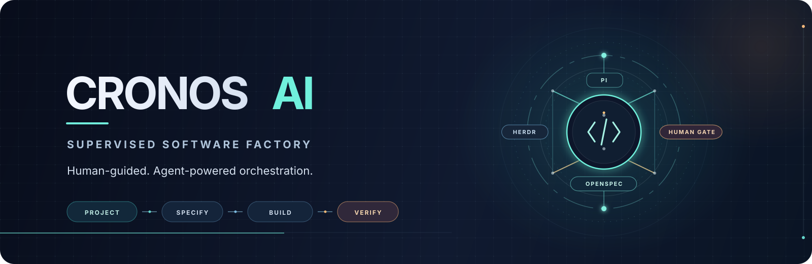
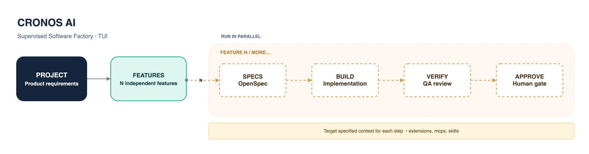
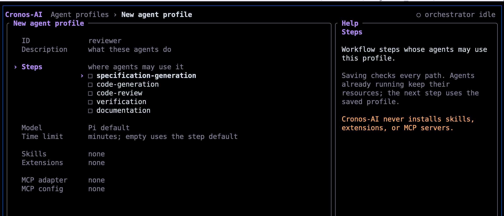

<p align="center">

</p>

# Cronos-AI

Cronos-AI is a supervised software factory for taking a project task through a structured, agent-assisted workflow.

It is an opinionated stack with a Rust TUI. Rust owns persisted task state, human approval gates, and the step loop of every task, a one-shot Pi planner proposes each step's agents, and Herdr runs the Pi agents that work in parallel within a step.

> [!WARNING]
> It's still a work in progress — it's not ready for production yet!

> [!NOTE]
> Tasks run one at a time by default; set a project's parallel capacity to run several on separate feature tracks. Which task starts next follows its priority, or an agent prioritizer on the model you choose (`project set-prioritizer <ID> agent --model <model>`).

## See it in action


A requirement is added and the planner proposes tasks for it.
The next task then runs from specification to local merge, with parallel writers and reviewers and two human approvals.
The project is fake, but the TUI and the task runner are real; only Herdr, Pi, and OpenSpec are stand-ins.
Re-record it with `mise run demo` (needs [VHS](https://github.com/charmbracelet/vhs)).

## What it does

- Manage projects and prioritized, dependency-aware tasks from the CLI and TUI.
- Record a project's functional and non-functional requirements and let a read-only Pi planner propose the tasks that cover them; nothing is created until you approve the plan.
- Monitor task status and agent activity in a terminal dashboard, as a table or a kanban board, with a progress summary and per-file diffs in the review view.
- Manage named Pi skill, extension, MCP, model, and time-limit profiles for workflow agents from the TUI.
- Run each task through specification, implementation, review, verification, approval, documentation, and local merge steps, one task at a time or several in parallel up to a per-project capacity, never two tasks that share a requirement. Agents report structured results; Rust decides each step from them and runs the project's check command before final approval.
- Drive each task with a Rust step loop: before every agent step, a one-shot, read-only Pi step planner proposes the agents and their prompts, with a templated default plan if it fails.
- Choose which ready task starts next by priority, or let an agent prioritizer decide on a model you pick, such as a fast selection model.
- Optionally run workers in a write sandbox that keeps them from changing Cronos data, the base checkout, and Git hooks.
- Send code back for automatic revision (up to 3 per attempt) when reviewers, verifiers, or the check command find problems.
- Require human approval of specifications and final code, with a review view of the spec, commits, diff, and check output; request revisions, retry a failed step, or recover failed attempts with additional context.
- Give each attempt an isolated local Git worktree. After final approval, changes are merged locally by default, or, per project, merged and pushed or opened as a pull request with the GitHub CLI. Projects can also tag each merge as a semantic-version release and record it in `CHANGELOG.md`.



The diagram shows several feature tracks running in parallel, each through the same per-task steps. A project runs one track by default; raise it with `project set-parallelism` or the **Parallel tasks** field of the project form.

## Requirements

On startup, Cronos-AI checks for required tools and prompts if any are missing; it does not install them automatically.

- A Rust toolchain to build the CLI and TUI.
- Pi for the worker agents and the one-shot planners.
- Herdr to manage agents and their work. Tasks only run when Cronos-AI is inside a Herdr session.
- OpenSpec as single source of truth. Each project repository needs a committed `openspec/` directory (`openspec init`, then commit).
- A Git repository and a check command (for example `./scripts/check.sh`) for each project that will run tasks. Each attempt gets its own worktree.

## Build and run

```sh
cargo build --release
```

Create a project linked to a repository and add a task:

```sh
./target/release/cronos-ai project create demo --repository /path/to/repository
./target/release/cronos-ai project set-check-command <PROJECT_ID> -- ./scripts/check.sh
./target/release/cronos-ai task create <PROJECT_ID> "Build the feature" --priority high
```

The commands print JSON containing the project and task IDs. After building, start the dashboard with the launcher:

```sh
./scripts/cronos-ai
```

From a regular terminal, the launcher creates or attaches to the dedicated `cronos-ai` Herdr session, starts Cronos-AI in its own workspace, and opens Herdr. When run inside a Herdr pane, it starts the TUI directly in that pane. For a TUI in the current terminal without the Herdr launcher, run `./target/release/cronos-ai` directly; supervised task execution requires Herdr.

Select the project with **Enter**, press **s** on its task list to start the next ready task, then open the task to monitor progress. At the specification and final-code gates, press **v** to review the work and **y** or **n** to approve or request a revision. If the TUI was closed while a task ran, **s** resumes it.

You can also create projects and tasks directly in the dashboard:

1. On the project list, press **n**. Enter a project name and optionally a description, local Git repository path, and check command. Use **Tab**/**Shift+Tab** to move between fields, **Enter** to save, or **Esc** to cancel.
2. Select the project with **Enter**. On its task list, press **n** to create a task. Enter a title and optional description; priority defaults to **Medium**. Use **Tab**/**Shift+Tab** to move between fields, **←/→** to change priority, and **↑/↓** plus **Space** to select task dependencies.
3. Press **Enter** to save. The task remains **Pending**; press **s** when you are ready to start the next ready task.

Or let Cronos-AI plan the tasks: on the task list press **g** to open the project's requirements, add them with **n**, and press **p** to run the planner. It reads the repository and its OpenSpec specs in the background and proposes tasks with priorities and dependencies; press **y** to create them or **x** to discard the plan. From the CLI:

```sh
./target/release/cronos-ai requirement add <PROJECT_ID> "Users can export any report as CSV"
./target/release/cronos-ai requirement add <PROJECT_ID> --kind non-functional "Exports finish within 2 seconds"
./target/release/cronos-ai project plan <PROJECT_ID>        # proposes a plan; creates nothing
./target/release/cronos-ai project plan-apply <PROJECT_ID>  # creates the planned tasks
```

The project form is only for new projects. To add a repository, check command, or check time limit to an existing project, use the CLI:

```sh
./target/release/cronos-ai project set-repository <PROJECT_ID> --repository /path/to/repository
./target/release/cronos-ai project set-check-command <PROJECT_ID> -- ./scripts/check.sh
./target/release/cronos-ai project set-check-timeout <PROJECT_ID> 90   # minutes, 1-480; omit to restore 60
./target/release/cronos-ai project set-parallelism <PROJECT_ID> 3      # tasks at a time, 1-8
```

## When something fails

Agents that crash, time out, or report failure stop the task with **Error**. Review, verification, and check-command findings instead send the code back to code generation automatically, up to 3 times per attempt. In an Error task's details:

| Key | Action |
|---|---|
| **t** | Retry only the failed step, keeping the attempt, worktree, and approvals. |
| **r** | Discard the attempt and start again from specification generation. |
| **c** | Like **r**, with extra context the new specifications must follow. |
| **a** | Abandon the task (Rejected) with a reason. |

A merge conflict sends the task back to code generation to resolve it. If the base repository has uncommitted changes, the task waits at local merge until you clean it and press **s**. See [workflow states](docs/workflow-states.md) for every outcome.

The data directory can be selected with `--data-dir DIR` or `CRONOS_AI_DATA_DIR`. Otherwise, Cronos-AI uses the platform's user data directory. See [storage format](docs/storage-format.md).

## Agent resource profiles

Every workflow agent loads a built-in skill for its step (see [`skills/`](skills/)). Profiles add Pi skills, extensions, MCP servers, a model, and a time limit on top. Manage them in the dashboard: press **p** on the project list to list, create, edit, and delete profiles. The editor checks every path before saving and shows which resources are missing.



You can also copy the example catalog into Cronos-AI's data directory and edit it by hand:

```sh
profile_dir="${CRONOS_AI_DATA_DIR:-${XDG_DATA_HOME:-$HOME/.local/share}/cronos-ai}"
mkdir -p "$profile_dir"
cp examples/agent-profiles.json "$profile_dir/agent-profiles.json"
```

Profiles have stable IDs and list the workflow steps where they can be selected. The step planner sees the eligible profiles for each step; workers load only their assigned profile resources. MCP profiles point to a separate Pi-compatible server config and an explicitly installed adapter. Cronos-AI does not install tools or run arbitrary profile shell hooks. See the [agent profile guide](docs/agent-profiles.md) and [sample catalog](examples/agent-profiles.json) for the format and details.

## Development

```sh
cargo test
./scripts/check.sh
```

The check script runs formatting, Clippy, all targets' tests, and `cargo audit`.
Run it automatically before every `git push` by installing the tracked hook once per clone:

```sh
mise install            # installs the pinned cargo-audit
mise run install-hooks  # points git at .githooks/
```

A failing check aborts the push; `git push --no-verify` skips it for a single push. End-to-end tests use temporary Git repositories with fake agents and a fake `herdr`:

```sh
cargo test --test workflow_e2e           # the full per-task workflow
cargo test --test herdr_agents_e2e       # Herdr agent lifecycle, cancellation, step lock
cargo test --test project_management_e2e # the CLI as a user drives it
```

The live smoke test starts one real Pi agent through Herdr. Run it by hand inside an isolated Herdr session:

```sh
CRONOS_LIVE_SMOKE=1 cargo test --test live_smoke -- --ignored --nocapture
```

Workers run with your operating-system permissions; `project set-sandbox <PROJECT_ID> on` keeps them from writing Cronos data, the base checkout, and Git hooks. See the [trust boundary](docs/integration-contracts.md#trust-boundary) before running untrusted work.

## Documentation

- [User guide](https://ixdi.github.io/cronos-ai/) (open in a browser)
- [Project/task commands and end-to-end use](docs/project-task-commands.md)
- [TUI monitoring and controls](docs/monitoring.md)
- [Workflow-agent profiles](docs/agent-profiles.md)
- [Workflow states and recovery](docs/workflow-states.md)
- [Storage format](docs/storage-format.md)
- [Pi, Herdr, and Git integration contracts](docs/integration-contracts.md)
- [System design](design/design.md)
- [Changelog](CHANGELOG.md)
